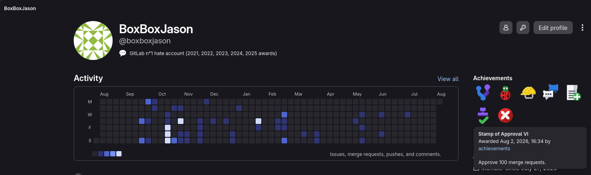
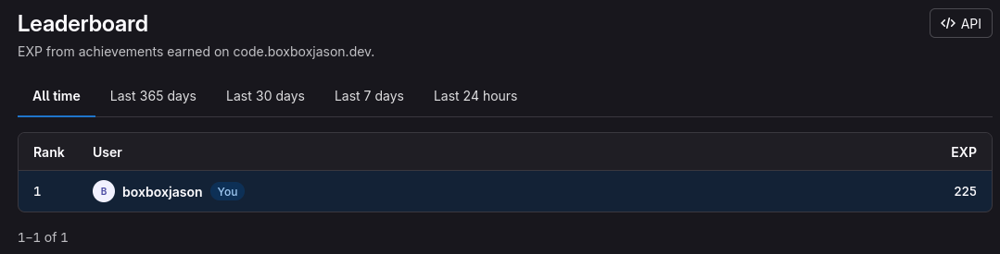
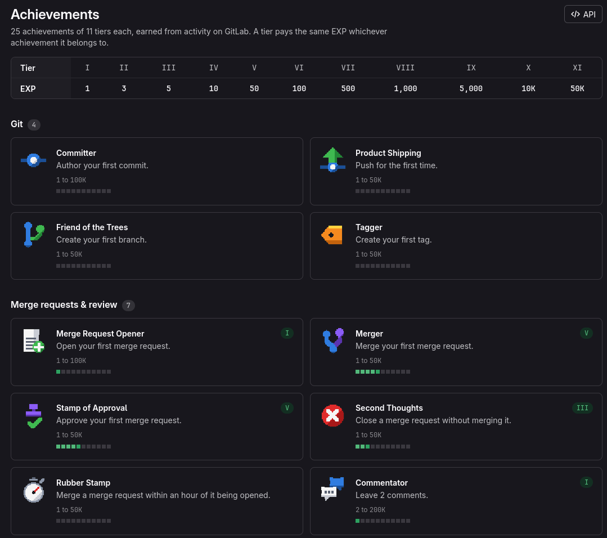
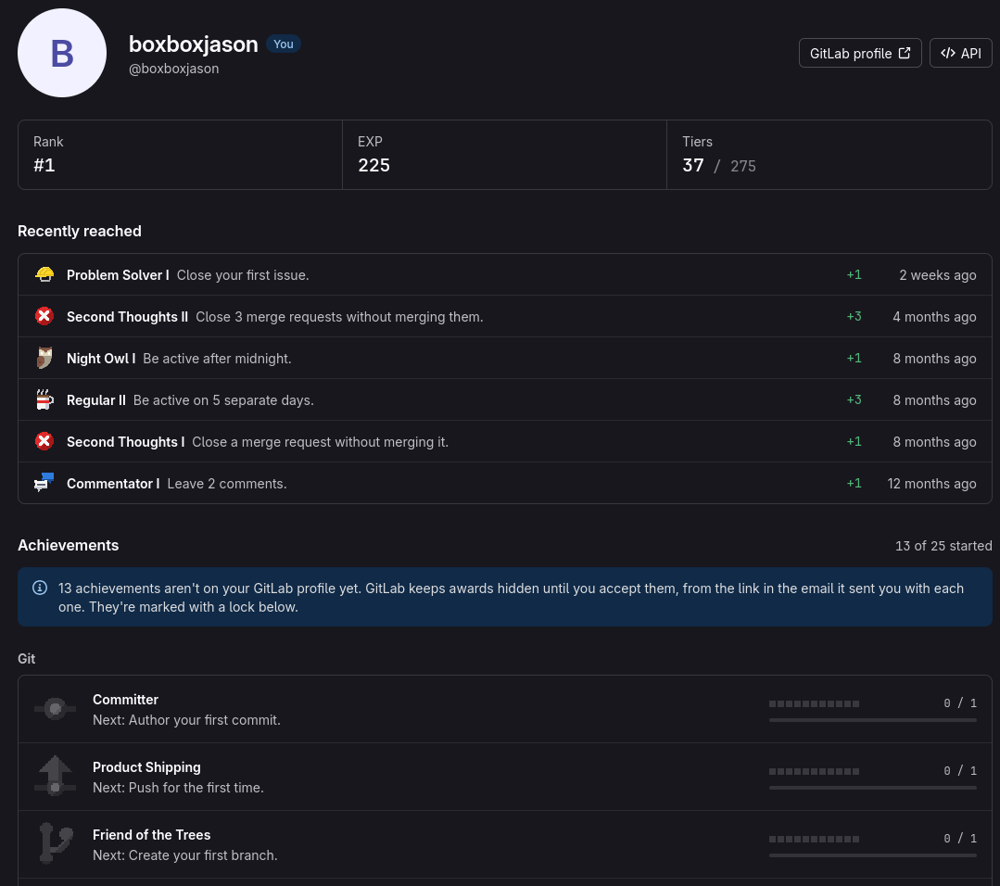

<div align="center">

# GitLab Achievements

**Turn your self-hosted GitLab into a game your team is already playing.**

[](https://github.com/BoxBoxJason/gitlab-achievements/releases)
[](https://github.com/BoxBoxJason/gitlab-achievements/pkgs/container/gitlab-achievements)
[](go.mod)
[](LICENSE)

</div>

Your instance already knows who ships code, who reviews it, and who keeps the pipelines green. This bot turns that into real [GitLab Achievements](https://docs.gitlab.com/user/profile/achievements/): **275 badges across 25 criteria**, awarded automatically, with an EXP total and an instance leaderboard on top.

Point it at a self-hosted GitLab and it takes care of itself. It creates the achievements, registers its own webhooks, walks your history once so nobody starts from zero, and from then on reacts to what people do as they do it.

It grew out of [BoxBoxJason/achievements](https://github.com/boxboxjason/achievements), a VS Code extension that gamifies local coding. Same idea, moved to the server, driven by real events instead of IDE telemetry.

> [!NOTE]
> Early days. Everything described here is implemented and covered by tests, but the project is young and GitLab's achievements API is still marked Experiment. Bug reports and [issues](https://github.com/BoxBoxJason/gitlab-achievements/issues) are very welcome.



Every one of the 25 criteria (commits, merge requests, reviews, pipelines, deployments, streaks, ...) stacks eleven tiers with names people actually want to collect: *Committer*, *Friend of the Trees*, *Rubber Stamp*, *Firefighter*, *Stuck the Landing*, *Night Owl*. Each tier is worth EXP, and the binary serves the instance leaderboard and everyone's progress toward their next tier. [The full catalog](https://boxboxjason.github.io/gitlab-achievements/docs/achievements/).



<p>
  
  
</p>

## Documentation

📖 **<https://boxboxjason.github.io/gitlab-achievements/>**

Start with the [GitLab-side setup](https://boxboxjason.github.io/gitlab-achievements/docs/gitlab-setup/), then pick a deployment: [Kubernetes](https://boxboxjason.github.io/gitlab-achievements/docs/deployment/kubernetes/), [Docker Compose](https://boxboxjason.github.io/gitlab-achievements/docs/deployment/docker-compose/) or a [bare binary](https://boxboxjason.github.io/gitlab-achievements/docs/deployment/bare-binary/). Every flag and environment variable is in [Configuration](https://boxboxjason.github.io/gitlab-achievements/docs/configuration/), and the EXP endpoints in [The API](https://boxboxjason.github.io/gitlab-achievements/docs/api/). The site is built from the [`docs`](docs) directory of this repository, so it is updated together with the code.

## Quick start

On any host with Docker Compose, once the [GitLab-side setup](https://boxboxjason.github.io/gitlab-achievements/docs/gitlab-setup/) is done:

```bash
git clone https://github.com/BoxBoxJason/gitlab-achievements.git
cd gitlab-achievements
cp .env.example .env
$EDITOR .env
docker compose up -d
```

The first start creates 275 achievements and registers webhooks before it serves anything. Once `/readyz` answers, you are live. More in the [Quick start](https://boxboxjason.github.io/gitlab-achievements/docs/quick-start/).

## Contributing

Bug reports, criteria ideas and pull requests are all welcome. [CONTRIBUTING.md](CONTRIBUTING.md) has the setup.

```bash
make build      # binary into ./bin
make test       # unit tests
make lint       # golangci-lint
make package    # container image
make helm/lint  # lint and render the Helm chart
make docs-serve # the documentation site, with live reload
```

## License

[MIT](LICENSE)
